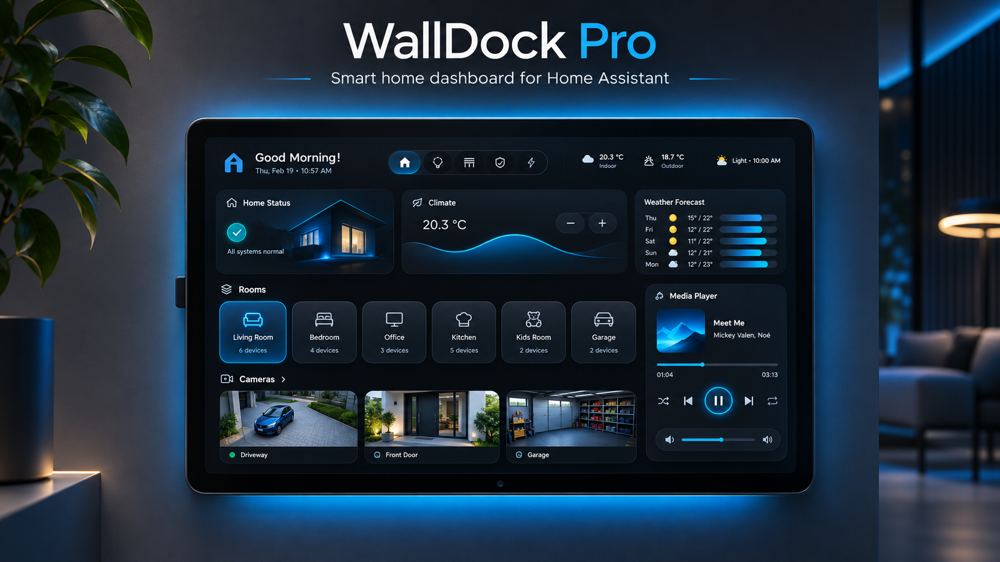

# WallDock Pro — téléchargements / downloads

**WallDock Pro** est la version Pro de [WallDock](https://github.com/psycho1807/WallDock), l'appli de tablette murale pour Home Assistant.
Ce dépôt contient uniquement les APK de WallDock Pro (pas le code source).

*WallDock Pro is the Pro edition of [WallDock](https://github.com/psycho1807/WallDock), the Home Assistant wall-tablet app. This repository only hosts the WallDock Pro APKs (no source code).*

## Télécharger / Download

➡️ **[Dernière version / Latest release](https://github.com/psycho1807/WallDock-Pro-Releases/releases/latest)** — fichier `WallDock-x.y.z-pro.apk`

Mises à jour automatiques dans l'appli, ou avec [Obtainium](https://github.com/ImranR98/Obtainium) (ajoutez l'adresse de ce dépôt).
*Automatic updates in the app, or with Obtainium (add this repository's URL).*

## Essai et licence / Trial and licence

- **3 jours d'essai gratuit**, toutes les fonctions Pro. *3-day free trial, all Pro features.*
- Ensuite : clé de licence (achat unique, 1 clé = 3 tablettes) → **[becasseau.gumroad.com/l/walldock-pro](https://becasseau.gumroad.com/l/walldock-pro)**
  *Then a licence key (one-time purchase, 1 key = 3 tablets).*
- Réglages → **Licence WallDock Pro** → coller la clé → **Activer**. *Settings → WallDock Pro licence → paste the key → Activate.*
- Sans licence, l'appli continue de fonctionner comme la version gratuite. *Without a licence, the app keeps working like the free version.*

## Nouveautés WallDock Pro 0.18.3 — Alfred et Gotham élégant

**Personnalisez le nom de votre assistant.** WallDock Pro peut afficher **A.L.F.R.E.D.**, J.A.R.V.I.S. ou un autre nom dans l'animation vocale. Le changement du nom affiché **ne modifie pas automatiquement le mot de réveil** : un mot personnalisé s'apprend directement sur la tablette (fonction expérimentale).

**Nouveau thème Gotham élégant pour les réponses vocales.** Quand l'assistant parle, l'animation peut adopter un style noir anthracite et bleu acier : cadran minimaliste animé, pulsations discrètes et panneau de réponse épuré. Pour l'écoute et la réflexion, le style habituel est conservé. **Classique** reste le choix par défaut.

**Réglages dans Home Assistant.** Via l'intégration ESPHome, le nom affiché de l'assistant, le nom du mot personnalisé et le choix **Classique / Gotham élégant** sont modifiables depuis HA. Les options de sélection du mot de réveil ont été stabilisées pour limiter les états inconnus. Si les nouvelles entités n'apparaissent pas, recharger l'intégration ESPHome de WallDock.

| Version | Principales évolutions |
|---|---|
| **0.18.3** | Thème vocal Gotham élégant et choix du style sur tablette ou dans Home Assistant |
| **0.18.2** | Synchronisation des noms assistant / mot personnalisé avec HA, correction des choix du mot de réveil |
| **0.18.1** | Nom affiché de l'assistant personnalisable (ex. Alfred) |

*English: Customizable assistant display name (e.g. Alfred), Home Assistant ESPHome settings for the assistant and custom wake word, plus the optional Gotham elegant speaking-only overlay. Classic remains the default. Training a custom wake word is a separate, local and experimental step.*

**Historique détaillé : [CHANGELOG.md](CHANGELOG.md).** Le téléchargement de l'APK dépend de sa présence dans [les versions publiées](https://github.com/psycho1807/WallDock-Pro-Releases/releases).

## Nouveautés WallDock Pro 0.18.0

**SmartFlow Daily** : quatre ambiances automatiques selon l'heure (matin, jour, soirée, nuit), avec météo et prévisions, événements du calendrier, état de la maison, sécurité et trafic, selon les entités disponibles dans Home Assistant.

**Jarvis** : reconnaissance faciale sur la tablette pour des salutations personnalisées, animation de l'assistant et réglages de voix française (voix unifiée expérimentale et facultative, avec repli sur l'audio Home Assistant).

**Compatibilité** : sélection manuelle ou détection des entités météo, calendrier, alarme et température, y compris pour les installations qui ne disposent pas de tous ces capteurs.

*Les visuels présents sur cette page sont illustratifs. Les fonctionnalités dépendent des autorisations Android et de la configuration Home Assistant.*

### Jarvis sur WallDock Pro

Voici une capture de l'interface Jarvis intégrée à WallDock Pro :

*Capture d'interface illustrative. L'affichage peut varier selon la tablette et les réglages.*

## Fonctions Pro / Pro features

- Mots de réveil au choix (Hey Jarvis, Okay Nabu, Alexa, Hey Mycroft…) et mot personnalisé — *wake word choice and custom wake word*
- Interphone entre tablettes — *intercom between tablets*
- Écran de la tablette en direct dans Home Assistant, avec clics et gestes — *live tablet screen in Home Assistant, with taps and swipes*
- Kiosque verrouillé (propriétaire de l'appareil) — *locked kiosk (device owner)*
- Administration à distance : page web + API REST — *remote admin web page + REST API*
- MQTT avec découverte Home Assistant — *MQTT with Home Assistant discovery*
- Onglets et lecteur PDF — *tabs and PDF viewer*

L'appli s'installe à côté de la version gratuite (`app.walldock.pro`). Confidentialité : [PRIVACY.md](https://github.com/psycho1807/WallDock/blob/main/PRIVACY.md).
*Installs alongside the free version. Privacy: see PRIVACY.md.*
