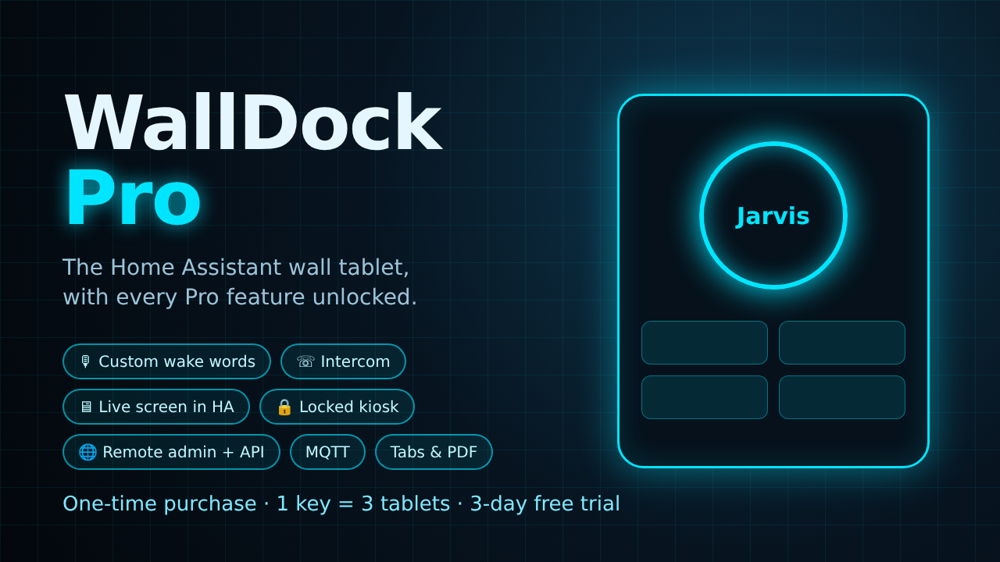

# WallDock Pro — téléchargements / downloads

**WallDock Pro** est la version Pro de [WallDock](https://github.com/psycho1807/WallDock), l'appli de tablette murale pour Home Assistant.
Ce dépôt contient uniquement les APK de WallDock Pro (pas le code source).

*WallDock Pro is the Pro edition of [WallDock](https://github.com/psycho1807/WallDock), the Home Assistant wall-tablet app. This repository only hosts the WallDock Pro APKs (no source code).*

## Télécharger / Download

➡️ **[Dernière version / Latest release](https://github.com/psycho1807/WallDock-Pro-Releases/releases/latest)** — fichier `WallDock-x.y.z-pro.apk`

Mises à jour automatiques dans l'appli, ou avec [Obtainium](https://github.com/ImranR98/Obtainium) (ajoutez l'adresse de ce dépôt).
*Automatic updates in the app, or with Obtainium (add this repository's URL).*

## Essai et licence / Trial and licence

- **3 jours d'essai gratuit**, toutes les fonctions Pro. *3-day free trial, all Pro features.*
- Ensuite : clé de licence (achat unique, 1 clé = 3 tablettes) → **[becasseau.gumroad.com/l/walldock-pro](https://becasseau.gumroad.com/l/walldock-pro)**
  *Then a licence key (one-time purchase, 1 key = 3 tablets).*
- Réglages → **Licence WallDock Pro** → coller la clé → **Activer**. *Settings → WallDock Pro licence → paste the key → Activate.*
- Sans licence, l'appli continue de fonctionner comme la version gratuite. *Without a licence, the app keeps working like the free version.*

## Fonctions Pro / Pro features

- Mots de réveil au choix (Hey Jarvis, Okay Nabu, Alexa, Hey Mycroft…) et mot personnalisé — *wake word choice and custom wake word*
- Interphone entre tablettes — *intercom between tablets*
- Écran de la tablette en direct dans Home Assistant, avec clics et gestes — *live tablet screen in Home Assistant, with taps and swipes*
- Kiosque verrouillé (propriétaire de l'appareil) — *locked kiosk (device owner)*
- Administration à distance : page web + API REST — *remote admin web page + REST API*
- MQTT avec découverte Home Assistant — *MQTT with Home Assistant discovery*
- Onglets et lecteur PDF — *tabs and PDF viewer*

L'appli s'installe à côté de la version gratuite (`app.walldock.pro`). Confidentialité : [PRIVACY.md](https://github.com/psycho1807/WallDock/blob/main/PRIVACY.md).
*Installs alongside the free version. Privacy: see PRIVACY.md.*
